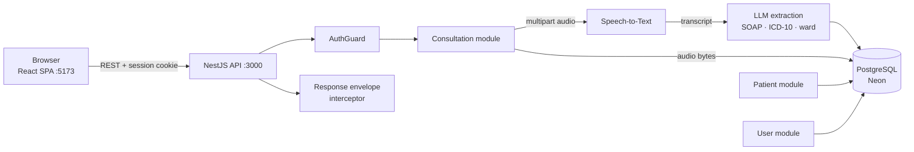

<p align="center">
  
</p>

<h1 align="center">ScribeHealth</h1>

<p align="center">
  <strong>Ambient clinical documentation for consultation-driven care.</strong><br/>
  Record the encounter — get a structured, review-ready SOAP note.
</p>

<p align="center">
  <a href="https://nestjs.com"></a>
  <a href="https://react.dev"></a>
  <a href="https://www.typescriptlang.org"></a>
  <a href="https://tailwindcss.com"></a>
  <a href="https://www.prisma.io"></a>
  <a href="https://www.postgresql.org"></a>
</p>

---

## Table of Contents

- [Overview](#overview)
- [Features](#features)
- [Tech Stack](#tech-stack)
- [Architecture](#architecture)
- [Project Structure](#project-structure)
- [Getting Started](#getting-started)
  - [Prerequisites](#prerequisites)
  - [Installation](#installation)
  - [Environment Variables](#environment-variables)
  - [Database Setup](#database-setup)
  - [Running Locally](#running-locally)
- [API Reference](#api-reference)
- [Data Model](#data-model)
- [Scripts](#scripts)
- [Testing & Linting](#testing--linting)
- [Building for Production](#building-for-production)
- [Author](#author)
- [License](#license)

---

## Overview

ScribeHealth is a full-stack clinical documentation suite. A clinician records a
consultation (or uploads an existing audio file); the platform transcribes the
encounter, structures it into a SOAP note with ICD-10 codes, a triage priority,
and a recommended ward, and keeps everything attached to a searchable patient
directory.

The workflow is deliberately review-first: nothing is silently accepted. Notes
open as drafts that the clinician can edit in place, approve, and export as a
signed PDF for the record.

The repository is a monorepo containing two independently runnable packages:

| Package  | Role                                          |
| -------- | --------------------------------------------- |
| `client/` | React SPA — recording studio, patients, notes |
| `server/` | NestJS REST API — pipeline, auth, persistence |

## Features

- **Live recording & upload** — capture consultations in the browser via
  microphone, or upload an existing audio file (MP3, WAV, WebM, M4A, FLAC; ≤ 10 MB).
- **Structured transcripts** — speaker-attributed, timestamped turn-by-turn view
  of the encounter, with the original audio available for playback.
- **SOAP note generation** — automatic Subjective / Objective / Assessment / Plan
  sections, ICD-10-CM codes, urgency priority (`URGENT` / `NORMAL` / `LOW`), and a
  recommended ward recommendation.
- **Review & approval workflow** — draft badge, in-place edit mode, save back to
  the database, approve & sign.
- **Patient directory** — searchable patient list (name / MRN), per-patient
  consultation history, walk-in badge, demographics editing.
- **PDF export** — one-click clinical report download (jsPDF), plus a signed &
  exported records vault persisted across sessions.
- **Authentication** — email/password auth with cookie-based sessions
  (better-auth), protected routes, and per-hospital data scoping.
- **Theme & responsive UI** — light/dark mode and layouts tuned for desktop,
  tablet, and mobile.

## Tech Stack

| Layer          | Technology                                                                 |
| -------------- | -------------------------------------------------------------------------- |
| Frontend       | React 18, TypeScript, Vite 6, Tailwind CSS 3, React Router 7               |
| Frontend libs  | axios, react-hot-toast, jsPDF, Material Symbols                            |
| Backend        | NestJS 12 (Express), TypeScript, class-validator                           |
| Database       | PostgreSQL (Neon) via Prisma 7 + `pg` connection pool                      |
| Auth           | better-auth (email/password, cookie sessions, Prisma adapter)              |
| Speech-to-text | Intron transcription API                                                  |
| Note extract.  | Groq (LLM-backed clinical data extraction)                                 |
| Benchmarking   | DeepGram (internal WER benchmark only — optional)                          |
| Tooling        | Vitest, supertest, oxlint, ESLint, Prettier                                |

## Architecture



Request lifecycle for a new consultation:

1. The client posts the recording to `POST /consultation/process-audio`.
2. The API upserts the patient, sends the audio for transcription, and receives a
   speaker-attributed transcript.
3. The transcript is passed to the extraction step, which returns a structured
   SOAP note, ICD-10 codes, priority, and ward recommendation.
4. The consultation is persisted together with the original audio bytes (a
   `bytea` column in Postgres, cached in the browser's IndexedDB for instant
   replay), and the full record is returned to the client.
5. Every response is wrapped by a global interceptor in a uniform envelope
   (`{ statusCode, error, message, data }`).

## Project Structure

```
.
├── client/                          # React SPA
│   ├── index.html
│   ├── tailwind.config.ts           # design tokens (color, type, motion)
│   ├── vite.config.ts
│   └── src/
│       ├── components/
│       │   ├── layout/              # TopNav, Sidebar, DashboardLayout, context drawer
│       │   ├── recording/           # command center, transcript feed, audio player
│       │   ├── soap/                # SOAP note editor + footer
│       │   ├── patients/            # patient card, summary, list
│       │   ├── modals/              # signed records
│       │   ├── auth/                # auth page panels
│       │   └── ui/                  # Button, Input, Select, ThemeToggle
│       ├── pages/                   # AuthPage, RecordingPage, PatientsPage
│       ├── services/                # API service layer (axios)
│       ├── config/                  # axios client + interceptors
│       ├── contexts/                # auth + theme providers
│       ├── hooks/                   # live recording, file upload
│       ├── lib/                     # PDF export + signed-record storage
│       └── types/                   # shared domain types
│
├── server/                          # NestJS API
│   ├── prisma/
│   │   ├── schema.prisma            # domain + auth models
│   │   └── migrations/
│   ├── prisma.config.ts             # Prisma CLI datasource config
│   ├── uploads/                     # legacy audio fallback (runtime, gitignored)
│   └── src/
│       ├── auth/                    # better-auth config, guard, decorators
│       ├── consultation/            # transcription pipeline, notes, audio
│       ├── patient/                 # patient CRUD + search
│       ├── user/                    # profile
│       ├── groq/                    # LLM client wrapper
│       ├── prisma/                  # PrismaService (Neon pg pool)
│       ├── benchmark/               # internal WER benchmarking (optional)
│       ├── util/                    # response envelope interceptor
│       ├── app.module.ts
│       └── main.ts                  # CORS, global prefix, validation pipe
│
└── README.md
```

## Getting Started

> **Deploying?** Follow the step-by-step **[DEPLOYMENT.md](DEPLOYMENT.md)** —
> backend on Render, frontend on Vercel, environment variables for both.

### Prerequisites

- **Node.js 20+** (LTS recommended) and **npm 10+**
- A **PostgreSQL** database — a free [Neon](https://neon.tech) project works out
  of the box
- API keys for the integrations you intend to use (see
  [Environment Variables](#environment-variables))

### Installation

```bash
git clone <your-repository-url>
cd ScribHealth

# API
cd server
npm install

# Web app (in a separate terminal)
cd ../client
npm install
```

### Environment Variables

**`server/.env`**

| Variable               | Required | Default               | Description                                                         |
| ---------------------- | -------- | --------------------- | ------------------------------------------------------------------- |
| `DATABASE_URL`         | Yes      | —                     | PostgreSQL connection string used by the Prisma CLI (push/migrate). |
| `DATABASE_URL_UNPOOLED`| Yes      | —                     | Direct (unpooled) connection string used by the runtime pg pool.    |
| `CLIENT_PREFIX`        | Yes      | `/api/v1`             | Global HTTP prefix for every API route (incl. auth).                |
| `PORT`                 | No       | `3000`                | API listen port.                                                    |
| `CLIENT_URL`           | No       | `http://localhost:5173` | Primary frontend origin trusted by auth.                          |
| `ALLOWED_ORIGINS`      | In prod  | —                     | Comma-separated list of origins the API accepts calls from (exact match, e.g. `https://app.vercel.app`). In production **only** these origins are allowed. |
| `BETTER_AUTH_SECRET`   | In prod  | —                     | Secret (≥ 32 chars) used to sign session cookies.                   |
| `BETTER_AUTH_URL`      | No       | —                     | Public URL of this API (https) used by auth.                        |
| `UPLOAD_DIR`           | No       | `uploads/consultations` | Override for the legacy on-disk audio fallback directory.         |
| `GROQ_API_KEY`         | Yes      | —                     | LLM provider key used for clinical note extraction.                |
| `INTRON_API_KEY`       | Yes      | —                     | Speech-to-text provider key used for transcription.                |
| `DEEPGRAM_API_KEY`     | No       | —                     | Only needed for the internal benchmark endpoint.                    |
| `NODE_ENV`             | No       | `development`         | `production` enables strict origin checking and secure cookies.     |

**`client/.env`**

| Variable           | Required | Example                          | Description                          |
| ------------------ | -------- | -------------------------------- | ------------------------------------ |
| `VITE_API_BASE_URL`| Yes      | `http://localhost:3000/api/v1`   | Base URL of the API (include prefix).|

### Database Setup

From `server/`, generate the Prisma client and sync the schema:

```bash
npx prisma generate
npx prisma db push
```

> The generated client lives in `server/src/generated/prisma` and is gitignored,
> so `prisma generate` is required after every fresh clone and after changing
> `prisma/schema.prisma`.

### Running Locally

```bash
# Terminal 1 — API (http://localhost:3000)
cd server
npm run dev

# Terminal 2 — Web app (http://localhost:5173)
cd client
npm run dev
```

Open **http://localhost:5173**, create an account on the sign-up screen, and you
land on the recording studio.

## API Reference

All routes are prefixed with `CLIENT_PREFIX` (default `/api/v1`) and — unless
noted — require an authenticated session. Every JSON response uses the same
envelope:

```json
{
  "statusCode": 200,
  "error": false,
  "message": "Success",
  "data": {}
}
```

### Auth — `better-auth`

| Method | Endpoint                    | Description                  |
| ------ | --------------------------- | ---------------------------- |
| POST   | `/auth/sign-up/email`       | Create an account            |
| POST   | `/auth/sign-in/email`       | Sign in (sets session cookie)|
| POST   | `/auth/sign-out`            | End the session              |
| GET    | `/auth/get-session`         | Current session / user       |

### Consultations

| Method | Endpoint                       | Description                                                                 |
| ------ | ------------------------------ | --------------------------------------------------------------------------- |
| POST   | `/consultation/process-audio`  | `multipart/form-data` — `file` (≤ 10 MB) plus optional patient fields (`mrn`, `firstName`, `lastName`, `gender`, `dateOfBirth`, `phone`). Creates/updates the patient, transcribes, extracts the note, and returns the consultation. |
| GET    | `/consultation/history`        | Recent consultations for the signed-in hospital, newest first.              |
| GET    | `/consultation/:id`            | Single consultation (includes patient).                                     |
| PUT    | `/consultation/:id`            | Update note fields (`subjective`, `objective`, `assessment`, `plan`).        |
| GET    | `/consultation/:id/audio`      | Stream the original recording for playback.                                 |

### Patients

| Method | Endpoint             | Description                                |
| ------ | -------------------- | ------------------------------------------ |
| GET    | `/patient`           | All patients for the signed-in hospital.   |
| GET    | `/patient/search?q=` | Search by name or MRN.                     |
| GET    | `/patient/:id`       | Patient profile with consultations.        |
| PUT    | `/patient/:id`       | Update demographics.                       |

### User

| Method | Endpoint   | Description          |
| ------ | ---------- | -------------------- |
| GET    | `/user/me` | Current profile.     |
| PATCH  | `/user/me` | Update profile.      |

### Internal

| Method | Endpoint          | Description                                                                 |
| ------ | ----------------- | --------------------------------------------------------------------------- |
| POST   | `/benchmark/run`  | Word-error-rate benchmark against a reference transcript (development tool). |

## Data Model

| Model                  | Purpose                                                                       |
| ---------------------- | ----------------------------------------------------------------------------- |
| `User`                 | Hospital account (name, email, location); owns patients and consultations.    |
| `Patient`              | Demographics + MRN; unique `(hospitalId, mrn)`.                               |
| `PatientConsultation`  | Raw transcript, S/O/A/P sections, `icd10Codes[]`, `Priority` enum, `recommendedWard`, original recording (`audioData` bytes + MIME), timestamp. |
| `Session` / `Account` / `Verification` | better-auth session and credential tables.                       |

Full schema: [`server/prisma/schema.prisma`](server/prisma/schema.prisma).

## Scripts

**Client** (`cd client`)

| Command           | Description                                  |
| ----------------- | -------------------------------------------- |
| `npm run dev`     | Start the Vite dev server with HMR (:5173).  |
| `npm run build`   | Type-check (`tsc -b`) and build for release. |
| `npm run preview` | Preview the production build locally.        |
| `npm run lint`    | Run ESLint.                                  |

**Server** (`cd server`)

| Command                | Description                         |
| ---------------------- | ----------------------------------- |
| `npm run dev`          | Start in watch mode (:3000).        |
| `npm run build`        | Compile to `dist/`.                 |
| `npm run start:prod`   | Run the compiled build.             |
| `npm run lint`         | Run oxlint.                         |
| `npm run format`       | Format sources with Prettier.       |
| `npm run test`         | Run unit tests (Vitest).            |
| `npm run test:cov`     | Run tests with coverage.            |
| `npm run test:e2e`     | Run end-to-end tests.               |

## Testing & Linting

```bash
# Server — unit/integration tests + lint
cd server
npm run test
npm run lint

# Client — type-check + lint
cd client
npm run build     # tsc -b runs first and fails on type errors
npm run lint
```

The server uses **Vitest** with **supertest** for HTTP-level tests; the client
relies on `tsc -b` strict type-checking and **ESLint**.

## Building for Production

```bash
# 1. Web app → static assets in client/dist
cd client
npm run build

# 2. API → compiled output in server/dist
cd server
npm run build
NODE_ENV=production npm run start:prod
```

Deployment notes:

- See **[DEPLOYMENT.md](DEPLOYMENT.md)** for the full Render + Vercel guide.
- Point `VITE_API_BASE_URL` at the deployed API (including the `CLIENT_PREFIX`).
- In production set `NODE_ENV=production` and list every frontend origin in
  `ALLOWED_ORIGINS` (comma-separated) — the API rejects all other origins.
- Consultation audio is stored **in the database** (`audioData`), so playback
  survives redeploys; the browser also caches fetched recordings in IndexedDB.
  `server/uploads/consultations/` is only a read-only fallback for legacy
  recordings (override its location with `UPLOAD_DIR`).
- Both `DATABASE_URL` (CLI) and `DATABASE_URL_UNPOOLED` (runtime) must be set in
  the production environment, plus `BETTER_AUTH_SECRET`.

## Author

**Amadi Tobias**
[amadiebube1@gmail.com](mailto:amadiebube1@gmail.com)

## License

All rights reserved. This project is unlicensed for redistribution — see the
`license` field in [`server/package.json`](server/package.json).
